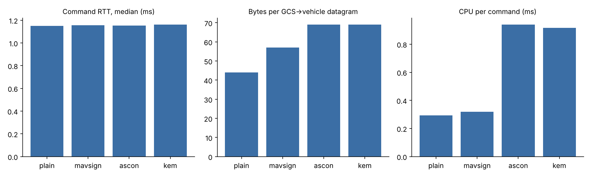

# Secure UAV Command-Link Testbed

A small, reproducible testbed that shows how an unprotected MAVLink 2 command link between a
ground control station (GCS) and a drone can be **replayed, injected and tampered with**, and that
compares three ways to protect it:

| Config | Protection | Keys |
|---|---|---|
| `plain` | none (baseline) | none |
| `mavsign` | MAVLink 2 message signing (HMAC-SHA256 truncated to 48 bits + timestamp) | 32-byte shared secret |
| `ascon` | Ascon-AEAD128 (NIST SP 800-232) on every datagram, timestamp sequence numbers | 16-byte pre-shared key |
| `kem` | ML-KEM-768 key establishment + ML-DSA-44 GCS authentication per session, then Ascon-AEAD128 with counters | vehicle KEM key pair, GCS signing key pair |

All experiments run in simulation on one machine. Do not point the attack code at real aircraft or
at systems you do not own.

## Architecture

```
GCS app ──UDP 14550──▶ GCS shim ──14551──▶ RELAY (attacker) ──14553──▶ vehicle shim ──▶ vehicle
                         │                    ▲  control :14599           │
                         └── protects ────────┘  replay / inject / tamper └── unprotects
vehicle = mock vehicle (udp 14560, default) or ArduPilot SITL (tcp 5760)
```

* `cmdlink/shim.py` – one process at each end of the link. In `ascon`/`kem` mode it seals every
  datagram as `type | seq | Ascon-AEAD128(ct‖tag)`; the 9-byte header is authenticated as
  associated data and a 64-entry sliding window rejects replays.
* `cmdlink/relay.py` – stands in for the radio link and the attacker. It has no keys.
* `cmdlink/mock_vehicle.py` – a minimal ArduCopter-like MAVLink 2 vehicle (heartbeat, `DO_SET_MODE`,
  `REQUEST_MESSAGE`, signing enforcement) so the testbed runs without building ArduPilot.
* `cmdlink/crypto.py` – channel, replay window and the handshake.
* `cmdlink/testbed.py` – starts all processes and runs the scenarios and benchmarks.

### ML-KEM handshake (`kem` mode)

```
GCS                                                     Vehicle
 HELLO(cn) ───────────────────────────────────────────▶
           ◀─────────────────────────────────────────── CHALLENGE(sn)
 (K, ct) = ML-KEM-768.Encaps(ek_vehicle)          [ek_vehicle pinned at the GCS]
 sig = ML-DSA-44.Sign(sk_gcs, label‖cn‖sn‖H(ct))
 KEM_INIT(ct, sig) ───────────────────────────────────▶ Verify(pk_gcs) → GCS authenticated
                                                        K = Decaps(dk_vehicle, ct)
 keys = HKDF-SHA256(K, salt=cn‖sn, info=H(transcript)) → one Ascon key per direction
           ◀─────────────────────────────────────────── KEM_ACK = Ascon(“ok”) → vehicle authenticated
```

The KEM alone only authenticates the vehicle (only it can decapsulate). The GCS signature is what
stops an attacker from opening its own session and sending commands; the fresh server nonce `sn`
stops a recorded handshake from being replayed.

## Quick start

```bash
python3 -m venv .venv && source .venv/bin/activate
pip install -r requirements.txt
pytest -q                                   # Ascon KAT (1,089 official vectors), replay window, handshake
python -m cmdlink.testbed attacks           # 3 attacks × 4 configs  → results/attacks_mock.csv
python -m cmdlink.testbed bench --n 1000    # latency / bytes / CPU  → results/bench_mock.csv, .png
python -m cmdlink.testbed crypto-bench      # per-primitive timings  → results/crypto_bench.csv
```

Keys are generated on first run into `keys/testbed_keys.json` (git-ignored).

## Results (mock vehicle, localhost, Python 3.13, 4 vCPU)

### Attacks

The operator first sets `GUIDED`; an attack succeeds if the vehicle ends up in `LAND`.

| Attack | plain | mavsign | ascon | kem |
|---|---|---|---|---|
| Replay of a captured `DO_SET_MODE(LAND)` | **succeeds** | blocked (old timestamp) | blocked (replay window) | blocked (replay window) |
| Injection of a forged command with the GCS's sysid/compid | **succeeds** | blocked (unsigned) | blocked (not a valid frame) | blocked (not a valid frame) |
| Tampering: operator's `LOITER` rewritten to `LAND` in flight, CRC recomputed | **succeeds** | blocked (signature) | blocked (tag check) | blocked (tag check) |

With protection, a tampered command is dropped rather than executed, so the operator's command is
also lost (integrity, not availability): the GCS must retry.

### Cost per command (1,000 `COMMAND_LONG` round trips per config)

| Config | RTT median (ms) | RTT p95 (ms) | Bytes GCS→vehicle | CPU per command (ms) | Handshake (ms) |
|---|---|---|---|---|---|
| plain | 1.15 | 1.26 | 44 | 0.29 | – |
| mavsign | 1.16 | 1.26 | 57 (+13) | 0.32 | – |
| ascon | 1.15 | 2.31 | 69 (+25) | 0.94 | – |
| kem | 1.16 | 2.27 | 69 (+25) | 0.92 | 51.5 |



### Primitive timings (pure Python)

| Operation | µs / op |
|---|---|
| HMAC-SHA256, 45 B (OpenSSL via `hmac`) | 1.1 |
| Ascon-AEAD128 encrypt, 45 B | 124 |
| Ascon-AEAD128 decrypt, 45 B | 123 |
| ML-KEM-768 encaps / decaps | 3,479 / 4,597 |
| ML-DSA-44 sign / verify | 29,308 / 5,628 |

### How to read these numbers

* On localhost the median RTT is dominated by Python process scheduling, so the **p95 RTT and CPU
  per command** are where the cryptographic cost shows. Over a real telemetry radio (SiK-class links run at tens of kbit/s),
  the extra 13–25 bytes per packet matter far more than the CPU time.
* HMAC runs in OpenSSL (C) while Ascon, ML-KEM and ML-DSA here are pure Python reference code, so
  the CPU comparison is unfair to Ascon by roughly two orders of magnitude. A C implementation
  (e.g. `ascon-c`, `liboqs`) is the fair next step.
* The handshake (~50 ms) happens once per session, so it does not affect per-command latency.

## Running against ArduPilot SITL (not yet verified in this repo)

```bash
# terminal 1 – ArduPilot built for SITL (see ArduPilot docs: "Setting up SITL on Linux")
Tools/autotest/sim_vehicle.py -v ArduCopter --no-mavproxy      # listens on tcp:127.0.0.1:5760
# wait ~30 s for GPS lock (GUIDED and LOITER need a position estimate)

# terminal 2
python -m cmdlink.testbed attacks --modes plain ascon kem --vehicle tcp:127.0.0.1:5760
python -m cmdlink.testbed provision-signing --url tcp:127.0.0.1:5760   # once, before mavsign
python -m cmdlink.testbed attacks --modes mavsign --vehicle tcp:127.0.0.1:5760
```

## Limitations and next steps

* PSK mode (`ascon`) uses timestamps for freshness; it assumes roughly synchronised clocks and
  accepts a replay of a frame younger than 5 s if the receiver restarts and loses its window.
  `kem` mode avoids this with fresh keys per session.
* MAVLink signing authenticates but does not encrypt; `ascon`/`kem` also hide command contents.
* No key rotation or session expiry yet.
* Next: C implementations for fair CPU numbers, a Raspberry Pi as the vehicle-side companion
  computer, and loss/latency emulation with `tc netem`.

## References

* MAVLink 2 message signing – https://mavlink.io/en/guide/message_signing.html
* NIST SP 800-232, Ascon-based lightweight cryptography standards
* NIST FIPS 203 (ML-KEM) and FIPS 204 (ML-DSA)
* RFC 4303 §3.4.3 (anti-replay sliding window)
